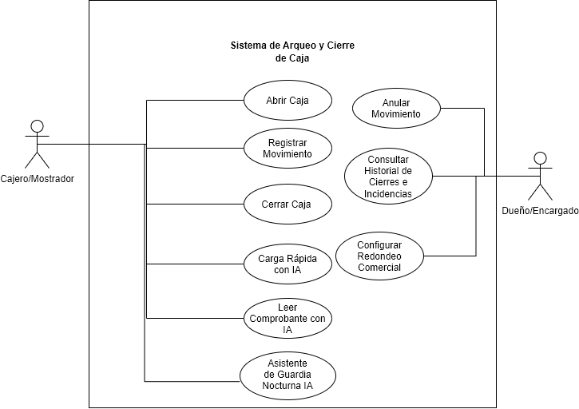

# 01. Especificación de Requerimientos de Software (ERS) — Alcance, Actores y Reglas de Negocio

> **Proyecto:** Sistema de Arqueo y Cierre de Caja Inteligente  
> **Versión:** 1.1 (MVP)  
> **Issue asociado:** `#1`  
> **Milestone:** `v0.1 - Análisis y Diseño Funcional`

---

## 1. Propósito

El propósito de esta Especificación de Requerimientos de Software (ERS) es definir de manera precisa el alcance funcional, los actores intervinientes, las reglas de negocio críticas y los requisitos funcionales y no funcionales del **Sistema de Arqueo y Cierre de Caja Inteligente** en su etapa de Producto Mínimo Viable (MVP).

Este documento sirve como contrato de referencia para el diseño del modelo de datos, la arquitectura en dos capas, el desarrollo y el plan de pruebas.

---

## 2. Alcance del Sistema

El sistema es una aplicación web *responsive* orientada a comercios con atención en mostrador que permite registrar de forma ágil todos los movimientos de dinero (ingresos y egresos) discriminados por método de pago, ejecutar el **arqueo y cierre de turno en 1 clic** y contar con un **Copiloto IA** para acelerar la carga operativa y asistir en contingencias.

### 2.1 Funcionalidades incluidas en el MVP
- Apertura de sesión/turno de caja con declaración de fondo inicial.
- Registro rápido de ingresos y egresos clasificados por método de pago (`Efectivo`, `Transferencia/QR`, `Tarjeta`).
- Anulación lógica auditable de movimientos erróneos con motivo obligatorio (sin borrado físico).
- Motor determinístico de redondeo comercial en efectivo y cálculo exacto de sobrantes/faltantes.
- Cierre de caja en 1 clic con bloqueo definitivo de la sesión e historial de arqueos.
- Copiloto IA (`gemini-4-hydrogen`) para carga por texto/voz, lectura de tickets y Asistente de Guardia Nocturna.

### 2.2 Exclusiones de esta primera entrega (Fuera de Alcance)
- Facturación electrónica (integración con AFIP / ARCA).
- Gestión de inventario / control de stock por código de barras.
- Multi-sucursal o consolidación contable entre múltiples razones sociales.
- Aplicaciones móviles nativas (iOS / Android); la solución opera como web *responsive*.
- Conciliación bancaria automática por scraping (en el MVP los pagos digitales se registran vía flujo controlado/webhook o confirmación del operador).

---

## 3. Características de los Usuarios (Actores)

| Perfil / Actor | Experiencia Técnica | Frecuencia de Uso | Funciones Principales |
| :--- | :--- | :--- | :--- |
| **Cajero / Mostrador** | Básica. Uso cotidiano de navegador o celular/tablet en mostrador. | Continua (durante todo el turno laboral). | Abrir turno con fondo inicial, registrar ingresos y egresos, usar el Copiloto IA (carga rápida y Asistente de Guardia Nocturna), ejecutar el cierre de caja de su turno. |
| **Encargado / Dueño** | Básica / Intermedia. Familiarizado con control comercial diario. | Diaria / Periódica (al finalizar turnos o auditar). | Supervisar movimientos en tiempo real, anular movimientos erróneos con motivo, configurar regla de redondeo comercial, consultar historial de cierres e incidencias nocturnas. |

---

## 4. Restricciones Generales, Supuestos y Dependencias

### 4.1 Restricciones Generales
- La interfaz debe operar íntegramente en español rioplatense, optimizada para lectura rápida en mostrador.
- Las operaciones monetarias deben almacenarse con precisión decimal exacta (prohibido el uso de tipos de punto flotante binario como `float`).
- La IA (`gemini-4-hydrogen`) **nunca** realiza cálculos contables ni altera saldos de forma autónoma; solo interpreta entradas y sugiere acciones que requieren confirmación explícita del usuario.
- Toda operación crítica debe registrar marca temporal (`America/Argentina/Buenos_Aires`) y usuario responsable.

### 4.2 Supuestos y Dependencias
- El comercio cuenta con conexión a Internet estable para sincronizar el libro de caja y consultar la API de Gemini.
- Los dispositivos de mostrador utilizan navegadores modernos (Chrome, Edge, Firefox o Safari actualizados) con JavaScript habilitado.
- Se dispone de una API Key válida de Google AI Studio para el entorno de Copiloto IA.

---

## 5. Reglas de Negocio Críticas (RN)

- **RN-01 — Inmutabilidad Contable y Anulación Lógica (Prohibido el borrado físico):** Ningún movimiento de caja puede eliminarse ni editarse en su monto o método de pago una vez registrado. Todo error de carga se corrige exclusivamente mediante una **anulación lógica** con motivo obligatorio: el registro cambia de estado `ACTIVO` a `ANULADO` (impidiendo una doble anulación) y guarda usuario responsable y fecha/hora exacta. Los cálculos de caja consideran únicamente los movimientos en estado `ACTIVO`.
- **RN-02 — Separación Estricta por Método de Pago y Fondo Inicial:** Todo movimiento debe asociarse obligatoriamente a un único método de pago (`EFECTIVO`, `QR_TRANSFERENCIA` o `TARJETA`). Los saldos esperados al cierre se calculan de forma independiente por cada canal. El **fondo inicial de cambio** declarado al abrir el turno aplica exclusivamente a `EFECTIVO`; los canales digitales inician cada turno en `$0,00`.
- **RN-03 — Conciliación Digital Cero-Descuadre:** Los canales digitales (`QR_TRANSFERENCIA` y `TARJETA`) no admiten redondeo comercial (`permite_redondeo = false`). Su monto esperado al cierre coincide de forma exacta con los movimientos activos del canal, salvo anulación documentada previa al cierre.
- **RN-04 — Margen de Tolerancia / Redondeo Comercial Configurable y Foto Histórica *(validado con relevamiento real en supermercado mayorista)*:** Por defecto el sistema opera en **modo estricto (`$0` — tolerancia cero)** para comercios con precios exactos. De forma opcional, el Encargado/Dueño puede configurar un **margen de tolerancia / redondeo comercial en efectivo** (ej. `$10`, `$100` o `$500`) para absorber centavos acumulados o diferencias menores de cambio:
  - Si un faltante en efectivo es **estrictamente menor al margen configurado** (ej. `-$300` con margen `$500`), se registra en `ajuste_redondeo` como **absorbido por la empresa** (no se descuenta al cajero), auditándose su **acumulado mensual por cajero** en el Panel de Encargado para detectar sesgos negativos (*anti robo hormiga*).
  - Si el faltante es **igual o mayor al margen** (ej. `-$500` o más), se imputa como **faltante real de caja**.
  - Al cerrar cada turno, el sistema persiste el margen vigente como **dato histórico inmutable**, garantizando que cambios futuros de configuración no alteren cierres anteriores.
- **RN-05 — Unicidad de Turno Activo y Bloqueo Post-Cierre:** No puede existir más de un turno de caja en estado `ABIERTO` simultáneamente (en el alcance mono-caja del MVP). Una vez confirmado el arqueo y pasado el turno a estado `CERRADO`, queda definitivamente bloqueado: no se admiten nuevos movimientos ni anulaciones sobre un turno cerrado.
- **RN-06 — Integridad Monetaria y Validación de Movimientos:** Todos los importes se almacenan con precisión decimal exacta (`DECIMAL(12,2)`). El monto de cualquier movimiento debe ser estrictamente mayor a cero (`> 0`), determinándose su efecto contable por el tipo (`INGRESO` o `EGRESO`). El fondo inicial y el efectivo físico declarado deben ser `>= 0`. En todo `EGRESO` la descripción o concepto es obligatorio.
- **RN-07 — Fórmula Determinística de Arqueo, Faltantes y Sobrantes:** Todos los cálculos del cierre se ejecutan en código determinístico (sin intervención de IA):
  - `Efectivo Esperado = Fondo Inicial + Ingresos Efectivo (activos) - Egresos Efectivo (activos)`
  - `Diferencia Bruta = Efectivo Declarado - Efectivo Esperado`
  - A partir de la diferencia bruta y el margen configurado (`RN-04`), el sistema discrimina explícitamente el **ajuste absorbido por tolerancia/redondeo** de la **diferencia real** (`Sobrante > 0`, `Faltante < 0`, `Exacto = 0`), cumpliendo siempre: `Diferencia Bruta = Ajuste por Redondeo + Diferencia Real`.
  - **Política de Sobrantes (`diferencia_real > 0`):** Todo sobrante queda registrado a favor de la empresa (nunca del cajero). Cuando el sobrante supera el margen de tolerancia (ej. cobro erróneo de `$20.000` en una compra de `$10.000`), el sistema destaca una alerta de **posible reclamo de cliente** para conservar respaldo contable ante una eventual devolución.
- **RN-08 — Segregación de Roles y Permisos:** Cada operación crítica valida el perfil del usuario autenticado. El **Cajero/Mostrador** puede abrir turno, registrar movimientos, utilizar el Copiloto IA y cerrar su turno. Únicamente el **Encargado/Dueño** puede anular movimientos, configurar el redondeo comercial, auditar el historial completo de cierres y marcar incidencias como resueltas (pudiendo también operar caja cuando cubre un turno).
- **RN-09 — Principio de Confirmación Humana sobre el Copiloto IA:** Ninguna salida de `gemini-4-hydrogen` (carga por voz/texto, lectura de comprobante o diagnóstico de descuadre) impacta de forma autónoma en el libro contable. Toda sugerencia se presenta como borrador editable que exige confirmación explícita del operador, registrándose el origen de carga (`MANUAL`, `IA_VOZ_TEXTO`, `IA_COMPROBANTE`).
- **RN-10 — Trazabilidad y Resolución de Incidencias de Turno:** Toda contingencia reportada durante la jornada (especialmente vía Asistente de Guardia Nocturna) queda obligatoriamente vinculada al turno de caja activo con categoría, resumen, usuario informante y estado de seguimiento (`PENDIENTE` / `RESUELTA`), registrando quién y cuándo la resolvió.

---

## 6. Requisitos Específicos

### 6.1 Requisitos Funcionales (RF)

| ID | Prioridad | Caso de Uso Asociado | Descripción |
| :--- | :---: | :--- | :--- |
| **RF-01** | Alta | `CU-AbrirCaja` | El sistema debe permitir al Cajero iniciar un nuevo turno declarando el monto de efectivo inicial (fondo de cambio `>= 0`), validando que no exista otro turno abierto. |
| **RF-02** | Alta | `CU-RegistrarMovimiento` | El sistema debe permitir registrar ingresos y egresos especificando monto (`> 0`), método de pago y una descripción (obligatoria en egresos). |
| **RF-03** | Alta | `CU-AnularMovimiento` | El sistema debe permitir al Encargado/Dueño anular un movimiento activo de un turno abierto ingresando un motivo obligatorio, marcándolo como `ANULADO` con trazabilidad de usuario y fecha/hora sin borrar el registro original. |
| **RF-04** | Alta | `CU-CerrarCaja` | El sistema debe calcular automáticamente los totales esperados por método de pago, solicitar el efectivo físico contado (o confirmar en 1 clic), aplicar la regla de redondeo vigente y calcular el sobrante o faltante exacto bloqueando el turno. |
| **RF-05** | Media | `CU-ConsultarHistorial` | El sistema debe permitir al Encargado/Dueño listar los cierres históricos y las incidencias filtrando por fecha y cajero, y copiar un resumen formateado. |
| **RF-06** | Media | `CU-CargaRapidaIA` | El sistema debe permitir al Cajero ingresar texto o audio en lenguaje natural para que `gemini-4-hydrogen` devuelva un borrador estructurado de movimiento listo para confirmar. |
| **RF-07** | Media | `CU-LeerComprobanteIA` | El sistema debe permitir subir la imagen de un ticket o comprobante para extraer automáticamente monto, fecha, concepto y método de pago sugerido. |
| **RF-08** | Alta | `CU-AsistenteNocturnoIA` | El sistema debe proveer un Asistente de Guardia que responda dudas operativas ante fallas en turno noche, analice posibles causas de descuadre y genere un parte de incidencia vinculado al turno. |
| **RF-09** | Media | `CU-ConfigurarRedondeo` | El sistema debe permitir al Encargado/Dueño configurar el margen de tolerancia / redondeo comercial aplicable a efectivo (`$0` estricto por defecto, o ej. `$10`, `$100`, `$500`), registrando usuario y fecha de modificación sin alterar cierres históricos. |

### 6.2 Requisitos No Funcionales (RNF)

| ID | Nombre | Descripción | Prioridad |
| :--- | :--- | :--- | :---: |
| **RNF-01** | Precisión Financiera | Todos los cálculos monetarios deben ejecutarse en código determinístico usando tipos decimales exactos o enteros en centavos. | Alta |
| **RNF-02** | Seguridad de Datos | Las credenciales y claves de API deben gestionarse mediante variables de entorno; nunca expuestas en el frontend ni en el repositorio. | Alta |
| **RNF-03** | Trazabilidad y Auditoría | Cada movimiento, anulación, cierre e incidencia debe almacenar usuario responsable y timestamp exacto. | Alta |
| **RNF-04** | Rendimiento en Mostrador | Las operaciones de registro rápido y cálculo de cierre deben responder en menos de `500 ms` (excluyendo latencia externa de IA). | Alta |
| **RNF-05** | Usabilidad (*Mobile-First*) | La interfaz debe ser utilizable cómodamente desde un celular o tablet en mostrador con botones táctiles amplios. | Media |

---

## 7. Diagrama de Casos de Uso

---

## 8. Plan de Riesgos Inicial

| # | Riesgo | Probabilidad | Impacto | Estrategia de Mitigación | Plan de Contingencia |
| :---: | :--- | :---: | :---: | :--- | :--- |
| **R1** | Errores de redondeo o precisión en montos con punto flotante. | Media | Alto | Prohibir `float`; operar con enteros en centavos o `Decimal` estricto desde la base de datos. | Ejecutar suite de pruebas unitarias sobre el motor de cierre antes de cada release. |
| **R2** | Alucinación o formato inválido de la IA al interpretar voz/tickets. | Media | Medio | Usar **Structured Outputs (JSON Schema)** en `gemini-4-hydrogen` y exigir confirmación manual previa. | Permitir edición manual inmediata del borrador o carga tradicional sin IA. |
| **R3** | Latencia o caída temporal de la API de Gemini en hora pico / turno noche. | Baja | Medio | Mantener el núcleo determinístico 100% desacoplado de la IA. | El mostrador sigue operando normalmente con carga manual y manual de contingencia local. |
| **R4** | Manipulación o borrado indebido de movimientos por error o fraude. | Media | Alto | Implementar inmutabilidad contable con anulación lógica (RN-01) y restringir anulaciones al rol Encargado/Dueño. | Auditar el historial de anulaciones y cierres por usuario. |
