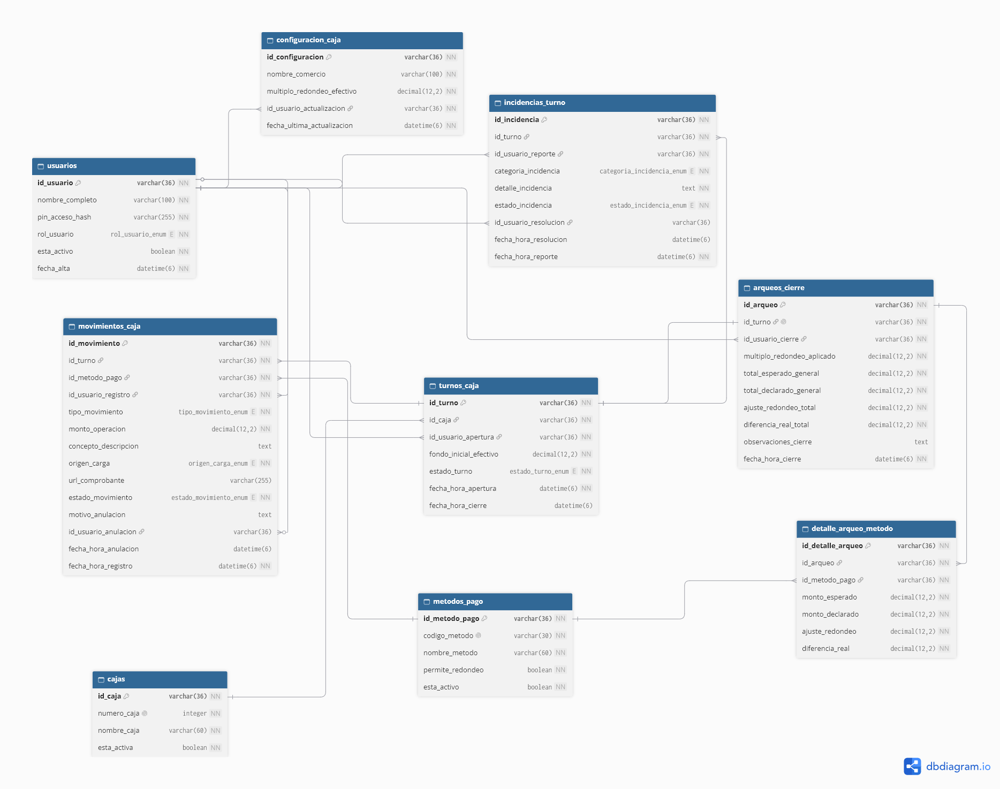

# 02. Modelo de Datos (DER) y Diccionario de Datos

> **Proyecto:** Sistema de Arqueo y Cierre de Caja Inteligente  
> **Versión:** 1.1 (MVP)  
> **Issue asociado:** `#11`  
> **Milestone:** `v0.1 - Análisis y Diseño Funcional`  
> **Documento de referencia:** [01 - Alcance, Actores y Reglas de Negocio](./01-alcance-y-reglas.md)

---

## 1. Decisiones de Diseño de Base de Datos

El modelo relacional fue diseñado en **Tercera Forma Normal (3FN)** respetando estrictamente las Reglas de Negocio (`RN-01` a `RN-10`) y los Requisitos No Funcionales (`RNF-01` a `RNF-03`):

- **Precisión monetaria exacta (`RNF-01` / `RN-06`):** Todos los importes utilizan `DECIMAL(12,2)`. Queda prohibido el uso de tipos de punto flotante (`FLOAT`/`DOUBLE`).
- **Identificadores únicos (`UUID`):** Todas las claves primarias utilizan `VARCHAR(36)` con nomenclatura explícita (`id_<entidad>`).
- **Inmutabilidad por anulación lógica (`RN-01`):** La tabla `movimientos_caja` nunca recibe operaciones `DELETE` ni modificaciones de importe; las correcciones cambian `estado_movimiento` a `ANULADO` registrando motivo, usuario y fecha/hora.
- **Desglose normalizado por método de pago (`RN-02` / `RN-03`):** En lugar de fijar columnas por canal en `arqueos_cierre`, el detalle se separa en `detalle_arqueo_metodo`, permitiendo incorporar nuevos medios de pago sin alterar el esquema.
- **Foto histórica del redondeo (`RN-04`):** `configuracion_caja` almacena el múltiplo vigente, mientras que `arqueos_cierre.multiplo_redondeo_aplicado` congela el valor usado en cada cierre para preservar la auditoría histórica.
- **Zona horaria y auditoría (`RNF-03`):** Todas las marcas temporales utilizan `DATETIME(6)` con referencia `America/Argentina/Buenos_Aires`.

---

## 2. Diagrama Entidad-Relación (DER)

---

## 3. Diccionario de Datos (8 Entidades)

### 3.1 `usuarios`
Almacena los operadores habilitados para autenticarse y operar según su rol (`RN-08`).

| Atributo | Tipo de Dato | Restricciones | Descripción |
| :--- | :--- | :--- | :--- |
| `id_usuario` | `VARCHAR(36)` | **PK**, `NOT NULL` | Identificador único UUID del usuario. |
| `nombre_completo` | `VARCHAR(100)` | `NOT NULL` | Nombre y apellido visible en auditorías y cierres. |
| `pin_acceso_hash` | `VARCHAR(255)` | `NOT NULL` | Hash seguro del PIN o contraseña de acceso rápido en mostrador. |
| `rol_usuario` | `ENUM('CAJERO', 'ENCARGADO')` | `NOT NULL` | Perfil funcional que determina los permisos del operador. |
| `esta_activo` | `BOOLEAN` | `NOT NULL`, `DEFAULT TRUE` | Permite deshabilitar usuarios sin perder historial de auditoría. |
| `fecha_alta` | `DATETIME(6)` | `NOT NULL` | Fecha y hora de creación del usuario. |

---

### 3.2 `configuracion_caja`
Centraliza los parámetros comerciales del local, en particular la regla de redondeo en efectivo (`RN-04` / `RF-09`).

| Atributo | Tipo de Dato | Restricciones | Descripción |
| :--- | :--- | :--- | :--- |
| `id_configuracion` | `VARCHAR(36)` | **PK**, `NOT NULL` | Identificador único de la configuración del comercio. |
| `nombre_comercio` | `VARCHAR(100)` | `NOT NULL` | Nombre del local para encabezados y resúmenes de cierre. |
| `multiplo_redondeo_efectivo` | `DECIMAL(12,2)` | `NOT NULL`, `CHECK (>= 0)` | Múltiplo vigente de redondeo comercial en efectivo (ej. `0.00`, `50.00`, `100.00`). |
| `id_usuario_actualizacion` | `VARCHAR(36)` | **FK** → `usuarios(id_usuario)`, `NOT NULL` | Último Encargado/Dueño que modificó la configuración. |
| `fecha_ultima_actualizacion` | `DATETIME(6)` | `NOT NULL` | Fecha y hora del último cambio de configuración. |

---

### 3.3 `metodos_pago`
Catálogo de canales de cobro y pago habilitados en el mostrador (`RN-02` / `RN-03`).

| Atributo | Tipo de Dato | Restricciones | Descripción |
| :--- | :--- | :--- | :--- |
| `id_metodo_pago` | `VARCHAR(36)` | **PK**, `NOT NULL` | Identificador único del método de pago. |
| `codigo_metodo` | `VARCHAR(30)` | `UNIQUE`, `NOT NULL` | Código interno inmutable (`EFECTIVO`, `QR_TRANSFERENCIA`, `TARJETA`). |
| `nombre_metodo` | `VARCHAR(60)` | `NOT NULL` | Nombre descriptivo mostrado en la interfaz. |
| `permite_redondeo` | `BOOLEAN` | `NOT NULL` | `TRUE` únicamente para `EFECTIVO`; `FALSE` en canales digitales (`RN-03`). |
| `esta_activo` | `BOOLEAN` | `NOT NULL`, `DEFAULT TRUE` | Indica si el método está disponible para nuevos movimientos. |

---

### 3.4 `turnos_caja`
Representa cada sesión o turno laboral de caja desde la apertura con fondo inicial hasta su cierre definitivo (`RN-05`).

| Atributo | Tipo de Dato | Restricciones | Descripción |
| :--- | :--- | :--- | :--- |
| `id_turno` | `VARCHAR(36)` | **PK**, `NOT NULL` | Identificador único del turno de caja. |
| `id_usuario_apertura` | `VARCHAR(36)` | **FK** → `usuarios(id_usuario)`, `NOT NULL` | Usuario que realizó la apertura del turno. |
| `fondo_inicial_efectivo` | `DECIMAL(12,2)` | `NOT NULL`, `CHECK (>= 0)` | Dinero de cambio inicial declarado en efectivo (`RN-02` / `RN-06`). |
| `estado_turno` | `ENUM('ABIERTO', 'CERRADO')` | `NOT NULL` | Estado del ciclo de vida. Solo puede existir un turno `ABIERTO` a la vez (`RN-05`). |
| `fecha_hora_apertura` | `DATETIME(6)` | `NOT NULL` | Marca temporal exacta de inicio del turno. |
| `fecha_hora_cierre` | `DATETIME(6)` | `NULL` | Marca temporal de cierre definitivo (`NULL` mientras esté `ABIERTO`). |

---

### 3.5 `movimientos_caja`
Libro diario inmutable de todos los ingresos y egresos registrados durante un turno (`RN-01`, `RN-06`, `RN-09`).

| Atributo | Tipo de Dato | Restricciones | Descripción |
| :--- | :--- | :--- | :--- |
| `id_movimiento` | `VARCHAR(36)` | **PK**, `NOT NULL` | Identificador único del movimiento. |
| `id_turno` | `VARCHAR(36)` | **FK** → `turnos_caja(id_turno)`, `NOT NULL` | Turno al que pertenece el movimiento. |
| `id_metodo_pago` | `VARCHAR(36)` | **FK** → `metodos_pago(id_metodo_pago)`, `NOT NULL` | Canal de pago asociado al movimiento (`RN-02`). |
| `id_usuario_registro` | `VARCHAR(36)` | **FK** → `usuarios(id_usuario)`, `NOT NULL` | Operador que confirmó y registró el movimiento. |
| `tipo_movimiento` | `ENUM('INGRESO', 'EGRESO')` | `NOT NULL` | Sentido contable de la operación. |
| `monto_operacion` | `DECIMAL(12,2)` | `NOT NULL`, `CHECK (> 0)` | Importe positivo exacto de la operación (`RN-06`). |
| `concepto_descripcion` | `TEXT` | `NULL` *(obligatorio si `EGRESO`)* | Detalle o motivo del movimiento. |
| `origen_carga` | `ENUM('MANUAL', 'IA_VOZ_TEXTO', 'IA_COMPROBANTE')` | `NOT NULL` | Trazabilidad de si fue carga manual o asistida por Copiloto IA (`RN-09`). |
| `url_comprobante` | `VARCHAR(255)` | `NULL` | Referencia al archivo/imagen del ticket escaneado (si aplica). |
| `estado_movimiento` | `ENUM('ACTIVO', 'ANULADO')` | `NOT NULL`, `DEFAULT 'ACTIVO'` | Estado lógico del movimiento. Solo los `ACTIVO` impactan en el saldo (`RN-01`). |
| `motivo_anulacion` | `TEXT` | `NULL` *(obligatorio si `ANULADO`)* | Justificación auditable ingresada al anular. |
| `id_usuario_anulacion` | `VARCHAR(36)` | **FK** → `usuarios(id_usuario)`, `NULL` | Encargado/Dueño que ejecutó la anulación (`RN-08`). |
| `fecha_hora_anulacion` | `DATETIME(6)` | `NULL` | Fecha y hora exacta de la anulación lógica. |
| `fecha_hora_registro` | `DATETIME(6)` | `NOT NULL` | Fecha y hora exacta de registro en el libro diario. |

---

### 3.6 `arqueos_cierre`
Registro formal e inmutable del cierre de un turno y sus totales consolidados (`RN-04`, `RN-07`).

| Atributo | Tipo de Dato | Restricciones | Descripción |
| :--- | :--- | :--- | :--- |
| `id_arqueo` | `VARCHAR(36)` | **PK**, `NOT NULL` | Identificador único del arqueo de cierre. |
| `id_turno` | `VARCHAR(36)` | **FK** → `turnos_caja(id_turno)`, `UNIQUE`, `NOT NULL` | Turno cerrado (relación estricta `1:1`). |
| `id_usuario_cierre` | `VARCHAR(36)` | **FK** → `usuarios(id_usuario)`, `NOT NULL` | Usuario responsable que confirmó el cierre. |
| `multiplo_redondeo_aplicado` | `DECIMAL(12,2)` | `NOT NULL` | Foto histórica del múltiplo de redondeo vigente al momento del cierre (`RN-04`). |
| `total_esperado_general` | `DECIMAL(12,2)` | `NOT NULL` | Suma de los montos esperados de todos los métodos de pago. |
| `total_declarado_general` | `DECIMAL(12,2)` | `NOT NULL` | Suma de los montos declarados/conciliados de todos los métodos de pago. |
| `ajuste_redondeo_total` | `DECIMAL(12,2)` | `NOT NULL` | Diferencia total absorbida por la regla de redondeo comercial (`RN-07`). |
| `diferencia_real_total` | `DECIMAL(12,2)` | `NOT NULL` | Resultado neto tras redondeo: sobrante (`> 0`), faltante (`< 0`) o exacto (`= 0`). |
| `observaciones_cierre` | `TEXT` | `NULL` | Comentarios adicionales del operador al cerrar el turno. |
| `fecha_hora_cierre` | `DATETIME(6)` | `NOT NULL` | Marca temporal exacta de confirmación del arqueo. |

---

### 3.7 `detalle_arqueo_metodo`
Desglose normalizado (3FN) del resultado del arqueo por cada método de pago (`RN-02`, `RN-03`, `RN-07`).

| Atributo | Tipo de Dato | Restricciones | Descripción |
| :--- | :--- | :--- | :--- |
| `id_detalle_arqueo` | `VARCHAR(36)` | **PK**, `NOT NULL` | Identificador único de la línea de desglose. |
| `id_arqueo` | `VARCHAR(36)` | **FK** → `arqueos_cierre(id_arqueo)`, `NOT NULL` | Arqueo de cierre al que pertenece el detalle. |
| `id_metodo_pago` | `VARCHAR(36)` | **FK** → `metodos_pago(id_metodo_pago)`, `NOT NULL` | Método de pago conciliado en esta línea. |
| `monto_esperado` | `DECIMAL(12,2)` | `NOT NULL` | Saldo calculado por el núcleo determinístico para este canal. |
| `monto_declarado` | `DECIMAL(12,2)` | `NOT NULL`, `CHECK (>= 0)` | Monto físico contado (en efectivo) o conciliado (en canales digitales). |
| `ajuste_redondeo` | `DECIMAL(12,2)` | `NOT NULL` | Ajuste por redondeo aplicado (`0.00` obligatorio si `permite_redondeo = FALSE`). |
| `diferencia_real` | `DECIMAL(12,2)` | `NOT NULL` | Diferencia real del canal (`monto_declarado - monto_esperado - ajuste_redondeo`). |

> **Restricción compuesta:** `UNIQUE (id_arqueo, id_metodo_pago)` — no puede repetirse un mismo método de pago dentro del mismo arqueo.

---

### 3.8 `incidencias_turno`
Partes de novedades y contingencias reportadas durante cualquier turno (mañana, tarde o noche, asistidas por el Asistente Operativo de Turno 24/7) (`RN-10`).

| Atributo | Tipo de Dato | Restricciones | Descripción |
| :--- | :--- | :--- | :--- |
| `id_incidencia` | `VARCHAR(36)` | **PK**, `NOT NULL` | Identificador único de la incidencia. |
| `id_turno` | `VARCHAR(36)` | **FK** → `turnos_caja(id_turno)`, `NOT NULL` | Turno en el cual ocurrió la contingencia. |
| `id_usuario_reporte` | `VARCHAR(36)` | **FK** → `usuarios(id_usuario)`, `NOT NULL` | Operador que reportó o confirmó el parte. |
| `categoria_incidencia` | `ENUM('POSNET', 'QR_PENDIENTE', 'DESCUADRE', 'SISTEMA', 'OTRO')` | `NOT NULL` | Clasificación del problema para filtrado y auditoría. |
| `detalle_incidencia` | `TEXT` | `NOT NULL` | Descripción estructurada del evento (redactada manualmente o asistida por IA). |
| `estado_incidencia` | `ENUM('PENDIENTE', 'RESUELTA')` | `NOT NULL`, `DEFAULT 'PENDIENTE'` | Estado de seguimiento administrativo. |
| `id_usuario_resolucion` | `VARCHAR(36)` | **FK** → `usuarios(id_usuario)`, `NULL` | Encargado/Dueño que marcó la incidencia como resuelta (`RN-08`). |
| `fecha_hora_resolucion` | `DATETIME(6)` | `NULL` | Fecha y hora de resolución. |
| `fecha_hora_reporte` | `DATETIME(6)` | `NOT NULL` | Fecha y hora de creación del parte. |

---

## 4. Resumen de Relaciones y Cardinalidades

| Entidad Origen | Cardinalidad | Entidad Destino | Rol de la Relación |
| :--- | :---: | :--- | :--- |
| `usuarios` | `1 : N` | `configuracion_caja` | Actualiza la regla de redondeo vigente (`id_usuario_actualizacion`). |
| `usuarios` | `1 : N` | `turnos_caja` | Abre turnos de caja (`id_usuario_apertura`). |
| `usuarios` | `1 : N` | `movimientos_caja` | Registra (`id_usuario_registro`) o anula (`id_usuario_anulacion`) movimientos. |
| `usuarios` | `1 : N` | `arqueos_cierre` | Confirma el arqueo y cierre (`id_usuario_cierre`). |
| `usuarios` | `1 : N` | `incidencias_turno` | Reporta (`id_usuario_reporte`) o resuelve (`id_usuario_resolucion`) incidencias. |
| `turnos_caja` | `1 : N` | `movimientos_caja` | Contiene los movimientos diarios del turno (`id_turno`). |
| `turnos_caja` | `1 : 0..1` | `arqueos_cierre` | Posee a lo sumo un arqueo de cierre definitivo (`id_turno` UNIQUE). |
| `turnos_caja` | `1 : N` | `incidencias_turno` | Agrupa los partes de contingencia ocurridos en el turno (`id_turno`). |
| `metodos_pago` | `1 : N` | `movimientos_caja` | Clasifica cada ingreso/egreso por canal (`id_metodo_pago`). |
| `arqueos_cierre` | `1 : N` | `detalle_arqueo_metodo` | Desglosa el cierre por cada método de pago (`id_arqueo`). |
| `metodos_pago` | `1 : N` | `detalle_arqueo_metodo` | Vincula cada línea de cierre con su canal (`id_metodo_pago`). |

---

## 5. Matriz de Trazabilidad (Reglas de Negocio → Modelo de Datos)

| Regla | Soporte en el Modelo de Datos |
| :--- | :--- |
| **RN-01** | `movimientos_caja.estado_movimiento`, `motivo_anulacion`, `id_usuario_anulacion`, `fecha_hora_anulacion` (sin borrado físico). |
| **RN-02** | `movimientos_caja.id_metodo_pago`, `turnos_caja.fondo_inicial_efectivo`, `detalle_arqueo_metodo`. |
| **RN-03** | `metodos_pago.permite_redondeo` (`FALSE` para digitales) y `detalle_arqueo_metodo.ajuste_redondeo = 0.00`. |
| **RN-04** | `configuracion_caja.multiplo_redondeo_efectivo` + foto histórica en `arqueos_cierre.multiplo_redondeo_aplicado`. |
| **RN-05** | `turnos_caja.estado_turno` (restricción de aplicación/índice parcial: máximo 1 turno `ABIERTO`) y `fecha_hora_cierre`. |
| **RN-06** | Tipos `DECIMAL(12,2)`, `CHECK (monto_operacion > 0)`, `CHECK (fondo_inicial_efectivo >= 0)`, `concepto_descripcion`. |
| **RN-07** | Columnas determinísticas en `arqueos_cierre` y `detalle_arqueo_metodo` (`monto_esperado`, `monto_declarado`, `ajuste_redondeo`, `diferencia_real`). |
| **RN-08** | `usuarios.rol_usuario` + trazabilidad por FK en cada tabla crítica. |
| **RN-09** | `movimientos_caja.origen_carga` y `url_comprobante`. |
| **RN-10** | `incidencias_turno` vinculada a `turnos_caja` con `estado_incidencia`, `id_usuario_resolucion` y `fecha_hora_resolucion`. |
