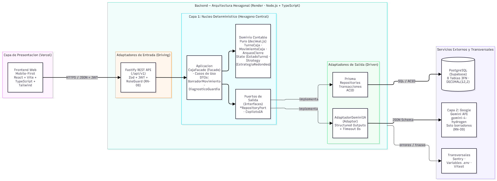
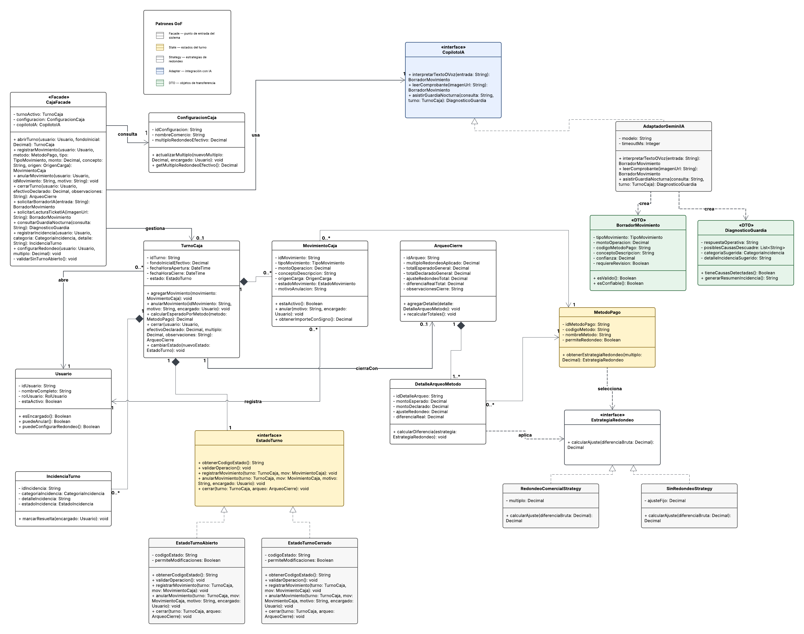
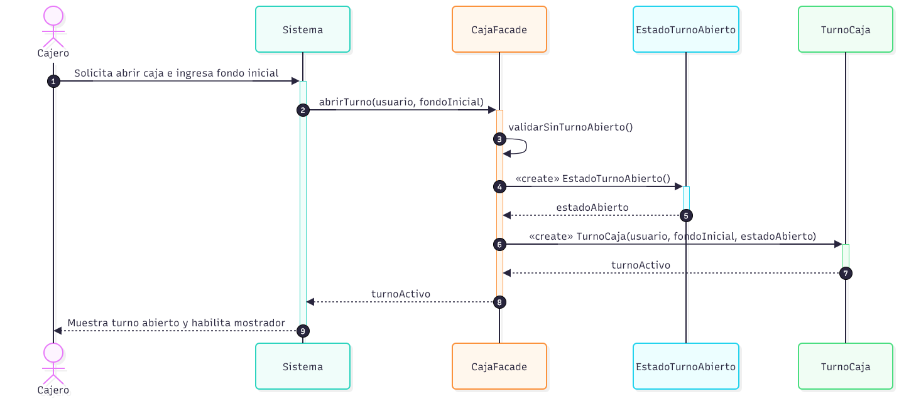
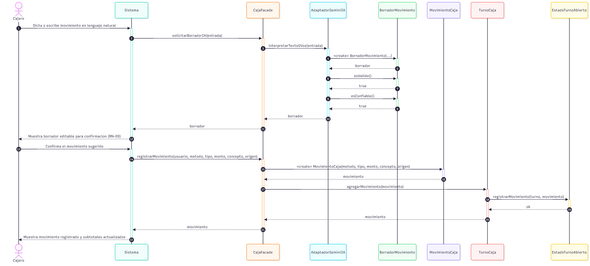
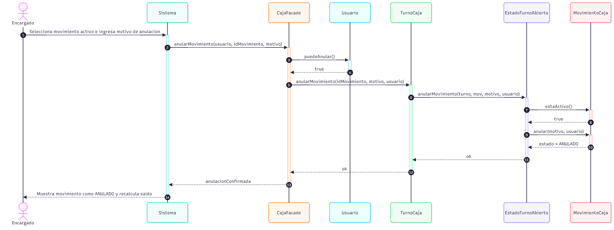
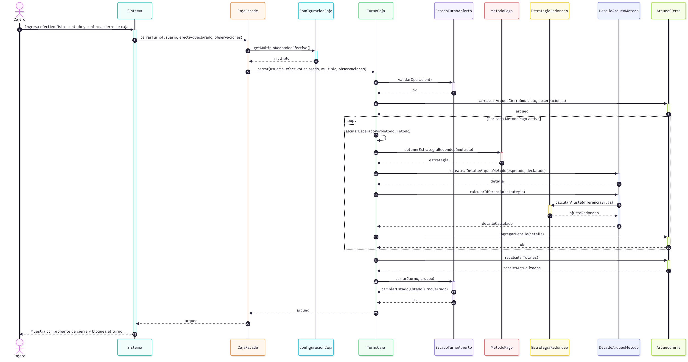

# 03. Arquitectura en 2 Capas (Backend Hexagonal) y Contratos de Integración

> **Proyecto:** Sistema de Arqueo y Cierre de Caja Inteligente  
> **Versión:** 1.1 (MVP)  
> **Issue asociado:** `#12`  
> **Milestone:** `v0.1 - Análisis y Diseño Funcional`  
> **Documentos de referencia:** [01 - ERS y Reglas de Negocio](./01-alcance-y-reglas.md) · [02 - Modelo de Datos (DER)](./02-modelo-datos.md)

---

## 1. Visión Arquitectónica: 2 Capas + Arquitectura Hexagonal

El sistema se construye sobre el principio de **separación estricta en 2 capas** implementado en el backend mediante **Arquitectura Hexagonal (Puertos y Adaptadores)**:

1. **Capa 1 — Núcleo de Caja Determinístico (Hexágono Central / Dominio):**
   - Contiene las reglas contables puras (`RN-01` a `RN-08`), entidades de dominio y el motor exacto de redondeo y arqueo.
   - **Cero dependencias externas:** no conoce Fastify, ni Prisma, ni el SDK de Gemini. Se prueba de forma aislada con tests unitarios determinísticos.
2. **Capa 2 — Copiloto IA (`gemini-4-hydrogen`) como Adaptador de Salida Desacoplado:**
   - Se integra detrás del puerto `CopilotoIAPort`.
   - Solo recibe entradas no estructuradas (texto, audio, foto de ticket o consulta operativa 24/7 de cualquier turno) y devuelve **borradores JSON validados** (*Structured Outputs*).
   - **Nunca** ejecuta operaciones de escritura ni cálculos contables (`RN-09`). Si la API de Gemini presenta latencia o caída (`R3`), el mostrador sigue operando al 100% en modo manual.

---

## 2. Stack Tecnológico Oficial (MVP)

| Capa | Tecnología | Rol / Justificación |
| :--- | :--- | :--- |
| **Frontend (Mostrador)** | **React + Vite + TypeScript + Tailwind CSS** | Interfaz *mobile-first*, rápida y táctil para celular, tablet o PC (`RNF-05`). |
| **Backend (API & Dominio)** | **Node.js + TypeScript + Fastify** | Bajo overhead (`< 500 ms`, `RNF-04`), tipado estricto y arquitectura hexagonal limpia. |
| **Precisión Monetaria** | **`decimal.js`** | Aritmética decimal exacta en memoria; prohíbe errores de punto flotante binario (`RNF-01`, `RN-06`). |
| **Validación de Contratos** | **Zod** | Validación estricta de requests HTTP y de respuestas JSON de Gemini API (`R2`). |
| **Persistencia / ORM** | **Prisma ORM + PostgreSQL (Supabase)** | Consultas tipadas, migraciones versionadas, transacciones atómicas y `DECIMAL(12,2)`. |
| **Copiloto IA** | **Google GenAI SDK (`@google/genai`) — `gemini-4-hydrogen`** | Multimodal nativo (texto, voz e imagen) con *Structured Outputs* (JSON Schema). |
| **Testing** | **Vitest** | Tests unitarios rápidos sobre el motor determinístico de redondeo y arqueo (`#5`). |
| **Despliegue y Monitoreo** | **Vercel (FE) + Render (BE) + Supabase (BD) + Sentry** | Infraestructura administrada con variables de entorno seguras (`RNF-02`). |

---

## 3. Diagrama de Arquitectura en 2 Capas (Hexagonal)



---

## 4. Diseño Orientado a Objetos y Patrones de Diseño (GoF)

Para mantener el núcleo contable limpio, extensible y desacoplado de frameworks o APIs externas, el diseño de clases aplica **4 Patrones de Diseño GoF** alineados directamente con las Reglas de Negocio (sin requerir modificaciones sobre el DER):

| Patrón GoF | Categoría | Clases / Interfaces | Regla que resuelve |
| :--- | :--- | :--- | :--- |
| **Facade** | Estructural | `CajaFacade` | Punto de entrada único para los flujos del mostrador (`abrirTurno`, `registrarMovimiento`, `anularMovimiento`, `cerrarTurno`, consultas al Copiloto IA). |
| **State** | Comportamiento | `EstadoTurno` (`<<interface>>`) → `EstadoTurnoAbierto`, `EstadoTurnoCerrado` | Garantiza **`RN-05`** por diseño OO: un turno cerrado bloquea automáticamente nuevos movimientos, anulaciones y recierres. |
| **Strategy** | Comportamiento | `EstrategiaRedondeo` (`<<interface>>`) → `RedondeoComercialStrategy`, `SinRedondeoStrategy` | Garantiza **`RN-03`** y **`RN-04`** por polimorfismo: aplica redondeo comercial al múltiplo en efectivo y `0.00` en canales digitales. |
| **Adapter** | Estructural | `CopilotoIA` (`<<interface>>`) → `AdaptadorGeminiIA` | Garantiza **`RN-09`** y **`R3`**: adapta el SDK de `gemini-4-hydrogen` a un puerto de dominio que solo retorna DTOs de borrador (`BorradorMovimiento`, `DiagnosticoGuardia`). |

### 4.1 Diagrama de Clases (Dominio + Patrones GoF)



---

## 5. Estructura del Backend Hexagonal (Puertos y Adaptadores)

```text
backend/
└── src/
    ├── domain/                          # NÚCLEO DETERMINÍSTICO (sin dependencias externas)
    │   ├── entities/                    # TurnoCaja, MovimientoCaja, ArqueoCierre, DetalleArqueoMetodo,
    │   │                                # MetodoPago, ConfiguracionCaja, IncidenciaTurno, Usuario
    │   ├── state/                       # EstadoTurno (interface), EstadoTurnoAbierto, EstadoTurnoCerrado
    │   ├── strategy/                    # EstrategiaRedondeo (interface), RedondeoComercialStrategy, SinRedondeoStrategy
    │   ├── value-objects/               # Dinero (basado en decimal.js)
    │   └── errors/                      # TurnoYaAbiertoError, TurnoCerradoError, RolNoAutorizadoError
    │
    ├── application/                     # FACHADA, CASOS DE USO, DTOs Y PUERTOS
    │   ├── facade/                      # CajaFacade (punto de entrada único)
    │   ├── dto/                         # BorradorMovimiento, DiagnosticoGuardia
    │   ├── ports/
    │   │   └── out/                     # Puertos de salida (interfaces)
    │   │       ├── TurnoRepositoryPort.ts
    │   │       ├── MovimientoRepositoryPort.ts
    │   │       ├── ArqueoRepositoryPort.ts
    │   │       ├── ConfiguracionRepositoryPort.ts
    │   │       ├── IncidenciaRepositoryPort.ts
    │   │       └── CopilotoIA.ts        # Puerto/Interface desacoplada para el Copiloto IA
    │   └── use-cases/                   # AbrirTurno, RegistrarMovimiento, AnularMovimiento,
    │                                    # CerrarTurno, ConfigurarRedondeo, ConsultarHistorial,
    │                                    # InterpretarCargaIA, LeerComprobanteIA, AsistirGuardiaIA
    │
    └── infrastructure/                  # ADAPTADORES (Entrada y Salida)
        ├── http/                        # Adaptadores primarios (Fastify routes, controllers, Zod, JWT/RoleGuard)
        ├── persistence/                 # Adaptadores secundarios (Prisma repositories + transacciones)
        └── ai/                          # Adaptador secundario (AdaptadorGeminiIA con gemini-4-hydrogen)
```

### Mapa de Puertos y Adaptadores

| Tipo | Puerto (Interfaz) | Adaptador Concreto | Responsabilidad |
| :--- | :--- | :--- | :--- |
| **Entrada (Driving)** | `CajaFacade` / Casos de Uso | `FastifyHttpController` + `ZodValidator` + `RoleGuard` | Expone la API REST, valida payloads y exige rol `CAJERO` / `ENCARGADO` (`RN-08`). |
| **Salida (Driven)** | `*RepositoryPort` | `Prisma*Repository` (PostgreSQL) | Persiste las 8 tablas del DER en transacciones atómicas. |
| **Salida (Driven)** | `CopilotoIA` | `AdaptadorGeminiIA` (`@google/genai`) | Invoca `gemini-4-hydrogen` con JSON Schema estricto, timeout 8s y manejo de fallos (`R3`). |

---

## 6. Diagramas de Secuencia Críticos (UML — Actor y Objetos)

Siguiendo el criterio de **1 diagrama = 1 Caso de Uso (curso normal limpio)**, cada secuencia modela la colaboración directa entre el actor, `:Sistema`, `:CajaFacade` y los objetos de dominio definidos en el Diagrama de Clases. Los cursos alternativos se documentan debajo de cada flujo.

### 6.1 Secuencia 1 — Abrir Turno de Caja (`CU-AbrirCaja` · `RN-02`, `RN-05`, `RN-06`)
- **Objetivo:** Validar unicidad de turno activo, instanciar `EstadoTurnoAbierto` y crear `TurnoCaja` con `fondoInicialEfectivo >= 0`.
- **Cursos alternativos:** Si ya existe un turno en estado `ABIERTO` (`RN-05`) o `fondoInicial < 0` (`RN-06`), `CajaFacade` rechaza la apertura sin crear objetos.



### 6.2 Secuencia 2 — Carga Rápida con Copiloto IA (`CU-CargaRapidaIA` · `RN-09`, `RN-06`)
- **Objetivo:** Interpretar texto/voz a través de `AdaptadorGeminiIA`, validar el `BorradorMovimiento` y registrar `MovimientoCaja` únicamente tras la confirmación humana del Cajero.
- **Cursos alternativos:** Si el Cajero descarta el borrador (`RN-09`) o Gemini excede el timeout (`R3`), no se instancia ningún `MovimientoCaja` y se habilita la carga manual.



### 6.3 Secuencia 3 — Anulación Lógica de Movimiento (`CU-AnularMovimiento` · `RN-01`, `RN-05`, `RN-08`)
- **Objetivo:** Verificar rol `ENCARGADO` (`Usuario.puedeAnular()`), validar que el turno siga abierto (`EstadoTurnoAbierto`) y marcar el movimiento como `ANULADO` con motivo obligatorio sin borrado físico.
- **Cursos alternativos:** Si el usuario es `CAJERO` (`RN-08`), el turno está en `EstadoTurnoCerrado` (`RN-05`), el movimiento ya fue anulado (`RN-01`) o el motivo está vacío, se lanza excepción sin modificar el movimiento.



### 6.4 Secuencia 4 — Arqueo y Cierre de Caja en 1 Clic (`CU-CerrarCaja` · `RN-04`, `RN-05`, `RN-07`)
- **Objetivo:** Obtener el múltiplo de redondeo vigente, calcular el desglose por `MetodoPago` aplicando `EstrategiaRedondeo` (`Strategy`), consolidar `ArqueoCierre` y transicionar el turno a `EstadoTurnoCerrado` (`State`).
- **Cursos alternativos:** Si el turno ya estaba cerrado (`EstadoTurnoCerrado.validarOperacion()`) o `efectivoDeclarado < 0` (`RN-06`), se cancela la operación sin modificar el turno.



---

## 7. Contrato de API REST (Endpoints del MVP)

Todos los endpoints protegidos requieren token JWT en `Authorization: Bearer <token>`.

| Método | Endpoint | Rol Permitido | Caso de Uso / Issue | Descripción |
| :--- | :--- | :---: | :--- | :--- |
| `POST` | `/api/v1/auth/login` | Público | Autenticación | Login rápido por usuario + PIN; devuelve JWT con `id_usuario` y `rol_usuario`. |
| `GET` | `/api/v1/turnos/activo` | `CAJERO`, `ENCARGADO` | `CU-AbrirCaja` (`#2`) | Devuelve el turno `ABIERTO` actual (o `null`) con subtotales en vivo por método. |
| `POST` | `/api/v1/turnos/abrir` | `CAJERO`, `ENCARGADO` | `CU-AbrirCaja` (`#2`) | Abre un nuevo turno con `fondo_inicial_efectivo >= 0`, validando unicidad (`RN-05`). |
| `POST` | `/api/v1/turnos/:idTurno/movimientos` | `CAJERO`, `ENCARGADO` | `CU-RegistrarMovimiento` (`#3`) | Registra un `INGRESO` o `EGRESO` (`monto_operacion > 0`, `origen_carga`). |
| `PATCH` | `/api/v1/movimientos/:idMovimiento/anular` | **`ENCARGADO`** | `CU-AnularMovimiento` (`#4`) | Ejecuta anulación lógica (`ANULADO`) exigiendo `motivo_anulacion` (`RN-01`, `RN-08`). |
| `GET` | `/api/v1/configuracion/caja` | `CAJERO`, `ENCARGADO` | `CU-ConfigurarRedondeo` (`#5`) | Consulta el `multiplo_redondeo_efectivo` vigente. |
| `PATCH` | `/api/v1/configuracion/caja` | **`ENCARGADO`** | `CU-ConfigurarRedondeo` (`#5`) | Actualiza el múltiplo de redondeo vigente sin afectar cierres históricos (`RN-04`). |
| `POST` | `/api/v1/turnos/:idTurno/cerrar` | `CAJERO`, `ENCARGADO` | `CU-CerrarCaja` (`#6`) | Ejecuta el motor determinístico, guarda `arqueos_cierre` + `detalle_arqueo_metodo` y cierra el turno. |
| `GET` | `/api/v1/arqueos` | **`ENCARGADO`** | `CU-ConsultarHistorial` (`#7`) | Lista historial de cierres con filtros por fecha y usuario + resumen formateado. |
| `GET` | `/api/v1/incidencias` | **`ENCARGADO`** | `CU-ConsultarHistorial` (`#7`, `#10`) | Lista partes de contingencia filtrables por turno y estado (`PENDIENTE`/`RESUELTA`). |
| `PATCH` | `/api/v1/incidencias/:idIncidencia/resolver` | **`ENCARGADO`** | `CU-AsistenteOperativoIA` (`#10`) | Marca una incidencia como `RESUELTA` registrando usuario y fecha/hora (`RN-10`). |
| `POST` | `/api/v1/ia/interpretar-movimiento` | `CAJERO`, `ENCARGADO` | `CU-CargaRapidaIA` (`#8`) | Recibe texto/audio y devuelve borrador JSON (no persiste en BD). |
| `POST` | `/api/v1/ia/leer-comprobante` | `CAJERO`, `ENCARGADO` | `CU-LeerComprobanteIA` (`#9`) | Recibe imagen de ticket/transferencia y devuelve borrador JSON (no persiste en BD). |
| `POST` | `/api/v1/ia/asistente-operativo` | `CAJERO`, `ENCARGADO` | `CU-AsistenteOperativoIA` (`#10`) | Asistente Operativo 24/7 para cualquier turno: orienta ante fallas o descuadres (solo lectura) y propone borrador de incidencia. |
| `POST` | `/api/v1/turnos/:idTurno/incidencias` | `CAJERO`, `ENCARGADO` | `CU-AsistenteOperativoIA` (`#10`) | Persiste el parte de incidencia en `incidencias_turno` tras confirmación del operador. |

---

## 8. Contrato con Gemini API (`gemini-4-hydrogen` — Structured Outputs)

El adaptador `AdaptadorGeminiIA` envía `responseMimeType: "application/json"` y un `responseSchema` estricto, revalidado en el backend con **Zod** antes de responder al Frontend (`R2`).

### 8.1 Contrato de Carga Rápida y Lectura de Comprobante (`#8` y `#9`)

```json
{
  "tipo_movimiento": "EGRESO",
  "monto_operacion": "8500.00",
  "codigo_metodo_pago": "EFECTIVO",
  "concepto_descripcion": "Pago a proveedor de soda",
  "confianza": 0.94,
  "requiere_revision": false,
  "advertencia": null
}
```

- `monto_operacion` se devuelve como **string decimal** (ej. `"8500.00"`) para parsearlo directo a `Decimal` sin pasar por punto flotante.
- El borrador se muestra editable en el Frontend; recién al confirmar se llama a `POST /api/v1/turnos/:idTurno/movimientos` con `origen_carga = 'IA_VOZ_TEXTO'` o `'IA_COMPROBANTE'`.

### 8.2 Contrato del Asistente Operativo de Turno 24/7 (`#10`)

Disponible para **todos los turnos (mañana, tarde y noche)** dentro del panel de chat del Copiloto IA (especialmente útil en guardias sin administración presencial):

```json
{
  "respuesta_operativa": "Si el posnet quedó sin señal pero el cliente ya tiene el débito en su app, pedí captura del comprobante y registrá una incidencia antes de cerrar el turno.",
  "posibles_causas_descuadre": [
    "Movimiento #14 ($12.500) cargado en EFECTIVO con concepto 'Transferencia cliente Mesa 3'."
  ],
  "borrador_incidencia": {
    "categoria_incidencia": "POSNET",
    "detalle_incidencia": "Corte intermitente de posnet durante el turno. Cobro de $12.500 verificado con captura de comprobante."
  }
}
```

### 8.3 Resiliencia y Degradación Elegante (`R3`)
- **Timeout máximo:** `8 segundos` por consulta a Gemini API.
- **Fallback operativo:** Ante error `429`, `503` o timeout, el backend retorna `503 Service Unavailable` con mensaje amigable y el mostrador habilita de inmediato el formulario manual tradicional sin interrumpir ventas ni cierres.

---

## 9. Garantías Técnicas de Integridad y Concurrencia

1. **Unicidad de turno abierto a nivel base de datos (`RN-05`):** además de la validación en el dominio, PostgreSQL aplica un índice único parcial que impide condiciones de carrera por doble clic:
   ```sql
   CREATE UNIQUE INDEX uniq_unico_turno_abierto
   ON turnos_caja (estado_turno)
   WHERE estado_turno = 'ABIERTO';
   ```
2. **Cierre atómico (`RN-05`, `RN-07`):** `CerrarTurnoUseCase` ejecuta en una única transacción (`prisma.$transaction`) la lectura con bloqueo del turno, la inserción en `arqueos_cierre` + `detalle_arqueo_metodo` y la actualización de `turnos_caja.estado_turno = 'CERRADO'`.
3. **Secretos protegidos (`RNF-02`):** `GEMINI_API_KEY`, `DATABASE_URL` y `JWT_SECRET` residen únicamente en variables de entorno del backend (Render); el frontend nunca tiene acceso directo a la API de Gemini ni a la base de datos.
