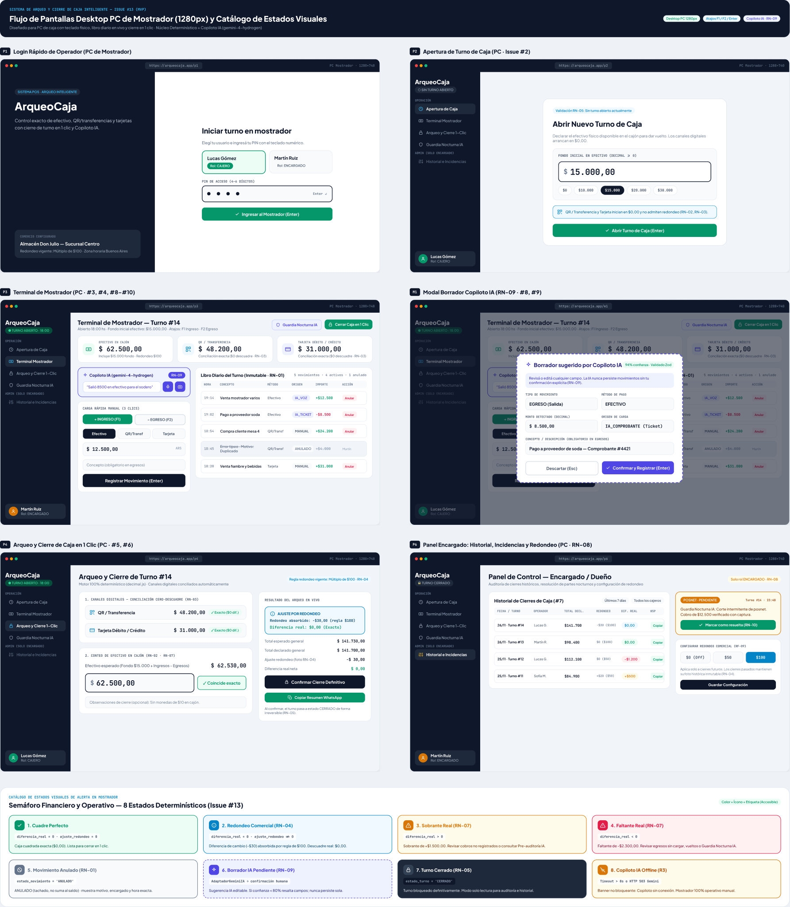
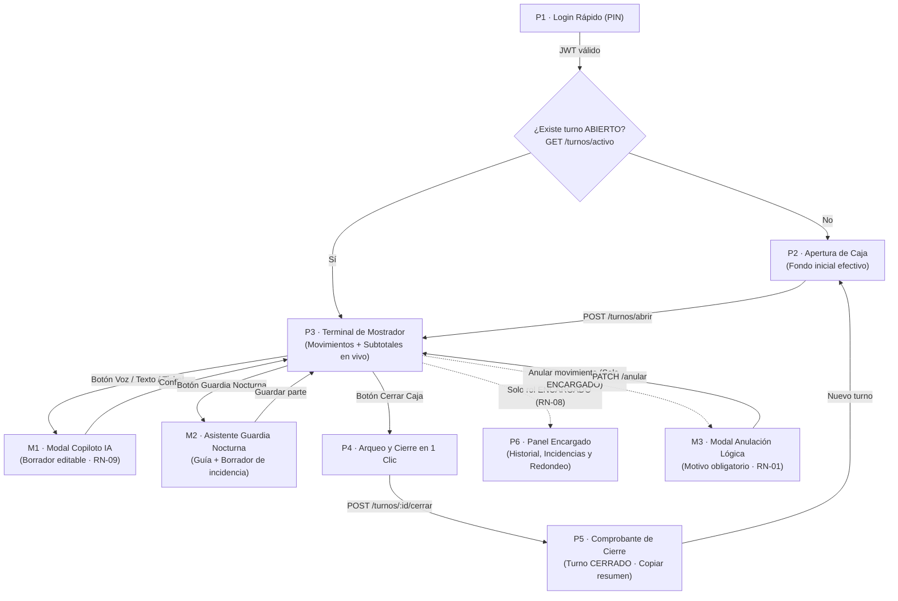

# 04. Flujo de Pantallas y Estados Visuales de Mostrador (UX/UI)

> **Proyecto:** Sistema de Arqueo y Cierre de Caja Inteligente  
> **Versión:** 1.0 (MVP)  
> **Issue asociado:** `#13`  
> **Milestone:** `v0.1 - Análisis y Diseño Funcional`  
> **Diseño interactivo en Figma:** [Ver archivo en Figma — Flujo de Pantallas (MVP)](https://www.figma.com/design/4zI3UPcfyBMwTlqohPu7vF)  
> **Documentos de referencia:** [01 - ERS y Reglas de Negocio](./01-alcance-y-reglas.md) · [02 - Modelo de Datos (DER)](./02-modelo-datos.md) · [03 - Arquitectura en 2 Capas](./03-arquitectura-dos-capas.md)

---

## Vista General del Diseño en Figma (Desktop PC de Mostrador — 1280px)

> 📌 **Criterio de plataforma:** Diseñado **Desktop-First para PC de mostrador (`1280×740`)** — el formato estándar en comercios — con soporte de teclado físico (`F1` Ingreso, `F2` Egreso, `Enter` Confirmar, `Esc` Descartar) y diseño *responsive* adaptable a tablet/celular (ver segunda pestaña en Figma).



---

## 1. Principios de Diseño UX para PC de Mostrador (*Desktop-First*)

La interfaz está pensada para el ritmo real de una PC de caja en hora pico y turno noche, priorizando:

1. **Regla de los 3 clics + teclado físico:** Registrar un ingreso o egreso manual toma menos de 3 segundos combinando atajos (`F1` Ingreso, `F2` Egreso, `Enter` Registrar) y teclado numérico físico.
2. **Libro diario siempre a la vista:** En `P3` la carga rápida (izquierda) y la tabla inmutable de movimientos (derecha) conviven sin necesidad de hacer scroll ni cambiar de pestaña.
3. **Confirmación explícita sobre la IA (`RN-09`):** Todo resultado de `gemini-4-hydrogen` (voz, texto o foto de ticket) abre el modal **`M1`** con borde índigo punteado y campos editables; nunca impacta de forma silenciosa.
4. **Semáforo financiero inmediato:** Los estados de cierre (**Cuadre perfecto**, **Redondeo comercial**, **Sobrante** y **Faltante**) usan color + ícono + etiqueta textual.
5. **Degradación elegante (`R3`):** Si el Copiloto IA no responde, se muestra un banner no bloqueante *"Copiloto sin conexión — usá la carga rápida manual"* sin interrumpir ventas ni cierres.

---

## 2. Mapa de Navegación (Flujo de Pantallas)



---

## 3. Especificación y Wireframes de Pantallas Clave

### P1 · Login Rápido por PIN (`/login`)
- **Actores:** `CAJERO` y `ENCARGADO`.
- **Propósito:** Cambio de operador en mostrador en menos de 3 segundos sin escribir correos largos.
- **Componentes:** Selector de operador activo (tarjetas grandes con nombre y rol) + teclado numérico de PIN (4–6 dígitos) + botón `Ingresar`.

```text
┌────────────────────────────────────┐
│  🧾 ArqueoCaja · Mostrador         │
├────────────────────────────────────┤
│  ¿Quién opera la caja?             │
│  [ 👤 Lucas · Cajero    ] (activo) │
│  [ ⭐ Martín · Encargado ]          │
│                                    │
│  Ingresá tu PIN                    │
│        ●  ●  ●  ○                  │
│   [ 1 ]    [ 2 ]    [ 3 ]          │
│   [ 4 ]    [ 5 ]    [ 6 ]          │
│   [ 7 ]    [ 8 ]    [ 9 ]          │
│   [ ⌫ ]    [ 0 ]    [ ✓ ]          │
└────────────────────────────────────┘
```

---

### P2 · Apertura de Caja (`/apertura`) — *Issue `#2`*
- **Actores:** `CAJERO` / `ENCARGADO`.
- **Reglas visibles:** Valida que no exista otro turno `ABIERTO` (`RN-05`) y `fondo_inicial_efectivo >= 0` (`RN-06`). Aclara explícitamente que el fondo inicial aplica solo a `EFECTIVO` (`RN-02`).

```text
┌────────────────────────────────────┐
│  Abrir Turno de Caja               │
│  Operador: Lucas (Cajero)          │
├────────────────────────────────────┤
│  Fondo inicial en EFECTIVO         │
│  (dinero de cambio en cajón)       │
│  ┌──────────────────────────────┐  │
│  │  $  15.000,00                │  │
│  └──────────────────────────────┘  │
│  Atajos: [$0] [$10.000] [$20.000]  │
│                                    │
│  ℹ QR/Transferencia y Tarjeta      │
│    inician automáticamente en $0   │
│                                    │
│  [     ▶ ABRIR TURNO DE CAJA    ]  │
└────────────────────────────────────┘
```

---

### P3 · Terminal de Mostrador (`/mostrador`) — *Issues `#3`, `#4`, `#8`, `#9`, `#10`*
- **Actores:** `CAJERO` (operación completa) y `ENCARGADO` (habilita acción `Anular` en cada fila y acceso a `Panel Encargado`).
- **Propósito:** Pantalla principal durante toda la jornada. Combina subtotales en vivo por canal, carga rápida manual en 3 toques y barra del Copiloto IA.

```text
┌──────────────────────────────────────────────────────────┐
│  🟢 TURNO ABIERTO · 18:00 hs    [🛡 Guardia IA] [⚙ Admin*]│
├──────────────────────────────────────────────────────────┤
│  EFECTIVO          QR / TRANSF.        TARJETA           │
│  $ 62.500          $ 48.200            $ 31.000          │
│  (inc. $15k fondo) (concil. exacta)    (concil. exacta)  │
├──────────────────────────────────────────────────────────┤
│  ✨ Copiloto IA: [ "Cobré 12.500 efec..."  ] [🎤] [📷]   │
├──────────────────────────────────────────────────────────┤
│  CARGA RÁPIDA MANUAL                                     │
│  [ + INGRESO ]  [ - EGRESO ]                             │
│  [ 💵 Efectivo ] [ 📱 QR/Transf ] [ 💳 Tarjeta ]         │
│  Monto: [ $ ________ ]   Concepto: [ ________________ ]  │
│  [              + REGISTRAR MOVIMIENTO                ]  │
├──────────────────────────────────────────────────────────┤
│  ÚLTIMOS MOVIMIENTOS DEL TURNO                           │
│  19:14  +$12.500  💵 Efectivo   Venta mostrador   [IA]   │
│  19:02  -$8.500   💵 Efectivo   Pago sodero       [📷]   │
│  18:45  +$4.000   📱 QR         ~~Error tipeo~~ [ANULADO]│
│         └ Motivo: "Monto duplicado" · por Martín (18:47) │
├──────────────────────────────────────────────────────────┤
│             [ 🔒 ARQUEO Y CIERRE EN 1 CLIC ]             │
└──────────────────────────────────────────────────────────┘
* Visible únicamente para rol ENCARGADO (RN-08).
```

---

### M1 · Modal Borrador del Copiloto IA (`RN-09`) — *Issues `#8` y `#9`*
- **Disparador:** Al enviar texto/voz (`POST /ia/interpretar-movimiento`) o foto de ticket (`POST /ia/leer-comprobante`).
- **Comportamiento clave:** Muestra todos los campos **editables**, badge de confianza (`94%`) y advertencia visual si `requiere_revision = true`. Nada se guarda hasta presionar **Confirmar**.

```text
┌────────────────────────────────────┐
│  ✨ Borrador sugerido por IA  94%  │
│  Revisá antes de guardar (RN-09)   │
├────────────────────────────────────┤
│  Tipo:     [ - EGRESO ▼ ]          │
│  Método:   [ 💵 EFECTIVO ▼ ]       │
│  Monto:    [ $ 8.500,00 ]          │
│  Concepto: [ Pago a proveedor soda]│
│                                    │
│  [ Descartar ]  [ ✓ Confirmar ]    │
└────────────────────────────────────┘
```

---

### P4 · Arqueo y Cierre de Caja en 1 Clic (`/cierre`) — *Issues `#5` y `#6`*
- **Propósito:** Conciliación sin fricción. Los canales digitales se muestran pre-conciliados (`ajuste = $0,00`, `diferencia = $0,00` por `RN-03`). El operador solo cuenta el efectivo físico o confirma en 1 clic si coincide exactamente.
- **Feedback en vivo:** Al tipear el efectivo contado, la tarjeta de resultado recalcula al instante `ajuste_redondeo` y `diferencia_real` aplicando el `multiplo_redondeo_efectivo` vigente (`RN-04`, `RN-07`).

```text
┌──────────────────────────────────────────────┐
│  🔒 Arqueo y Cierre de Turno                 │
│  Regla redondeo vigente: Múltiplo de $100    │
├──────────────────────────────────────────────┤
│  CANALES DIGITALES (Conciliación exacta)     │
│  📱 QR / Transferencia   $ 48.200,00   ✓ OK  │
│  💳 Tarjeta              $ 31.000,00   ✓ OK  │
├──────────────────────────────────────────────┤
│  EFECTIVO EN CAJÓN                           │
│  Esperado (con $15.000 fondo):  $ 62.530,00  │
│                                              │
│  Efectivo físico contado:                    │
│  [ $ 62.500,00 ]   [ ✓ Coincide exacto ]     │
│                                              │
│  ┌────────────────────────────────────────┐  │
│  │ 🔵 AJUSTE POR REDONDEO COMERCIAL       │  │
│  │ Redondeo absorbido: -$30,00 (regla $100)│ │
│  │ Diferencia real de caja: $0,00 (Exacto)│  │
│  └────────────────────────────────────────┘  │
│                                              │
│  Observaciones (opcional): [ _____________ ] │
│  [ ⚠ CONFIRMAR CIERRE DEFINITIVO DEL TURNO ] │
└──────────────────────────────────────────────┘
```

---

### P5 · Comprobante de Cierre (`/cierre/:idArqueo`) — *Issues `#6` y `#7`*
- **Propósito:** Confirmar que el turno pasó a `CERRADO` (`RN-05`) y ofrecer el botón **`📋 Copiar resumen para WhatsApp`** con el desglose completo (fecha, operador, totales por método, redondeo aplicado, diferencia real e incidencias del turno).

---

### P6 · Panel de Encargado (`/admin`) — *Issues `#5`, `#7` y `#10`*
- **Acceso:** Exclusivo rol `ENCARGADO` (`RN-08`; devuelve HTTP `403` a `CAJERO`).
- **3 pestañas simples:**
  1. **Historial de Cierres y Acumulado por Cajero:** Filtros por rango de fechas y operador, semáforo de diferencia por turno, **acumulado mensual de tolerancia/redondeo por cajero** *(control anti robo hormiga, `RN-04`)* y botón de copiar resumen.
  2. **Incidencias de Turno (Guardia Nocturna):** Listado con filtro `PENDIENTE` / `RESUELTA` y acción `✓ Marcar como resuelta` (registra `id_usuario_resolucion` y `fecha_hora_resolucion`, `RN-10`).
  3. **Configuración de Tolerancia / Redondeo (`RF-09`):** Selector de margen (`$0 Estricto por defecto`, `$10`, `$100`, `$500` o valor personalizado `>= 0`) con aviso explícito: *"Este cambio aplica solo a cierres futuros; los cierres históricos conservan su regla original (`RN-04`)"*.

---

## 4. Catálogo de Estados Visuales de Alerta en Mostrador

| Estado Visual | Condición Determinística | Paleta / Semáforo | Ícono | Mensaje de Mostrador |
| :--- | :--- | :--- | :---: | :--- |
| **Cuadre Perfecto** | `diferencia_real = 0` y `ajuste_redondeo = 0` | Verde (`emerald-600` / fondo `emerald-50`) | ✅ | **Caja cuadrada exacta ($0,00).** Lista para cerrar en 1 clic. |
| **Dentro de Tolerancia / Redondeo (`RN-04`)** | `diferencia_real = 0` y `0 < \|ajuste_redondeo\| < margen` | Azul / Celeste (`sky-600` / fondo `sky-50`) | 🔵 | **Absorbido por margen de tolerancia del local.** No se imputa faltante al cajero; queda registrado para control mensual. |
| **Sobrante Real (`RN-07`)** | `diferencia_real > 0` | Ámbar (`amber-600` / fondo `amber-50`) | ⚠️ | **Sobrante de `+$X` (queda para la empresa).** Si supera el margen, alerta posible cobro de más a cliente para respaldo ante reclamo/devolución. |
| **Faltante Real Imputable (`RN-07`)** | `diferencia_real < 0` *(o faltante `>= margen`)* | Rojo (`rose-600` / fondo `rose-50`) | 🚨 | **Faltante real de `-$X` (imputable al cierre).** Sugerencia: revisar egresos sin cargar o usar *Pre-auditoría IA* antes de confirmar. |
| **Movimiento Anulado** | `estado_movimiento = 'ANULADO'` | Gris neutro (`slate-500`) + texto tachado | 🚫 | **ANULADO** *(no suma al saldo)* — muestra motivo, encargado y hora (`RN-01`). |
| **Borrador IA (`RN-09`)** | Respuesta de `AdaptadorGeminiIA` pendiente | Violeta / Índigo (`indigo-600` / borde punteado) | ✨ | **Sugerencia IA pendiente de confirmación.** Si `confianza < 0.80`, resalta campos a revisar. |
| **Turno Cerrado (`RN-05`)** | `estado_turno = 'CERRADO'` | Gris oscuro (`zinc-700`) + controles deshabilitados | 🔒 | **Turno cerrado y bloqueado.** Solo lectura para auditoría. |
| **Copiloto IA Offline (`R3`)** | Timeout `> 8s` o error `503` de Gemini | Ámbar suave (banner no bloqueante) | 📡 | **Copiloto IA temporalmente no disponible.** Podés seguir cargando manualmente sin interrupciones. |
